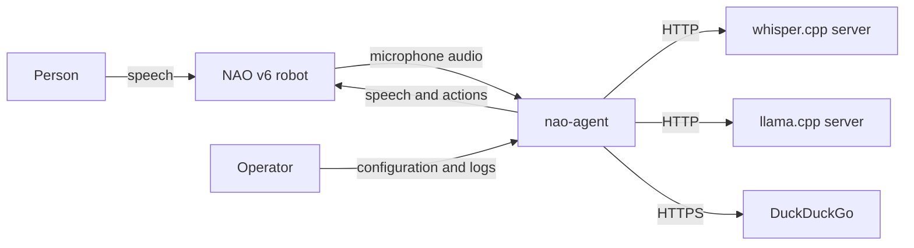
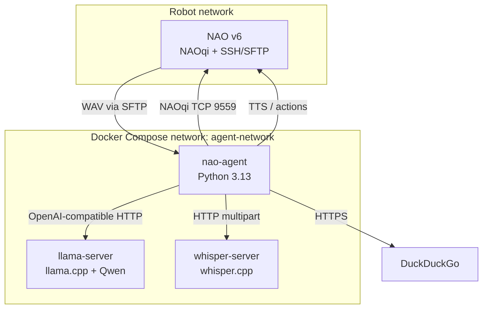
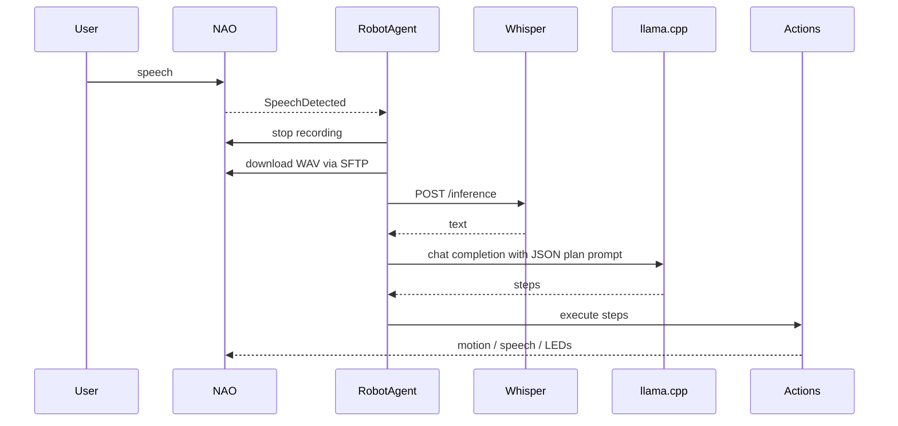

# Architecture Overview

This document is the living architecture reference for **NAO Agent**. It describes the
current system and the target boundaries; it is not a promise that every target boundary
already exists. Update it when the architecture changes.

## 1. Project Structure

```text
nao-agent/
├── python/                     # Application source
│   ├── main.py                 # Composition root and entry point
│   ├── config.py               # Environment-based configuration
│   ├── prompts/                # Tracked LLM prompt resources
│   ├── agent/                  # Conversation, LLM, ASR, parsing, execution
│   │   ├── agent.py            # Conversation loop
│   │   ├── asr.py              # whisper.cpp client
│   │   ├── llm.py              # OpenAI-compatible llama.cpp client
│   │   ├── response_parser.py  # LLM output parsing (to be replaced in M1)
│   │   ├── speech_detector.py  # Speech trigger and recording window
│   │   └── step_executor.py    # Step execution and follow-up
│   └── robot/                  # NAOqi adapters
│       ├── robot.py            # Robot facade and connection lifecycle
│       ├── actions.py          # Robot actions and action registry
│       ├── audio.py            # Recording and SFTP transfer
│       └── eyes.py             # LED animations
├── docs/
│   ├── adr/                    # Architecture Decision Records
│   ├── contracts/              # LLM response contract
│   └── plans/                  # Milestones, status, test matrix
├── infra/                      # Production Docker Compose stack
├── tests/                      # Unit, contract, integration, SIL tests
├── ARCHITECTURE.md
├── AGENTS.md
├── Dockerfile
└── docker-compose.yml          # Dev and production helper services
```

## 2. High-Level System Diagram

### 2.1 System context



### 2.2 Container view



### 2.3 Conversation sequence (current)



## 3. Core Components

### 3.1 Conversation agent

- **Name:** `RobotAgent` (`python/agent/agent.py`)
- **Responsibility:** run the listen → transcribe → generate → execute loop, handle
  connection failures, and coordinate robot state.
- **Technologies:** Python 3.13, `paramiko` exceptions, module loggers.
- **Target boundary:** `nao_conversation`; a state machine is introduced in M3.

### 3.2 Speech recognition adapter

- **Name:** `WhisperASR` (`python/agent/asr.py`)
- **Responsibility:** upload the captured WAV file to whisper.cpp and return text.
- **Technologies:** `httpx`, whisper.cpp HTTP server.
- **Target boundary:** `nao_audio_pipeline` / ASR adapter.

### 3.3 LLM adapter

- **Name:** `LLMManager` (`python/agent/llm.py`)
- **Responsibility:** maintain conversation context, call the local OpenAI-compatible
  endpoint, retry transient API errors, and expose the system prompt builder.
- **Technologies:** OpenAI Python SDK, llama.cpp server.
- **Target boundary:** `nao_conversation` + `nao_intent_parser`.
- **Known gap:** structured output is not enforced yet; this is M1.

### 3.4 Response parser and step executor

- **Names:** `response_parser.py`, `step_executor.py`
- **Responsibility:** recover a plan from model text, execute speech and action steps, run
  follow-up generation for actions that need a result.
- **Technologies:** `json`, `re`, `ThreadPoolExecutor`.
- **Target boundary:** `nao_intent_parser` + `nao_intent_dispatcher`.
- **Known gaps:** regex parsing, hardcoded actions that need a response, and unsafe
  timeout semantics; addressed in M1–M3.

### 3.5 Robot facade and NAOqi adapters

- **Names:** `Robot`, `RobotActions`, `RobotAudio`, `RobotEyes`
- **Responsibility:** connect to NAOqi, record and download audio, speak, animate LEDs,
  and execute robot actions.
- **Technologies:** `qi` (libqi-python), NAOqi services (`ALRobotPosture`, `ALMotion`,
  `ALMemory`, `ALBattery`, `ALTextToSpeech`, `ALAudioRecorder`, `ALSpeechRecognition`,
  `ALLeds`), SSH/SFTP via `paramiko`.
- **Target boundary:** `nao_state_manager`, `nao_motion_executor`, `nao_audio_pipeline`.
- **Known gap:** the facade is large and the reconnect lifecycle is duplicated; M2–M3
  introduce ports and a supervisor.

### 3.6 Configuration and composition

- **Names:** `python/config.py`, `python/main.py`
- **Responsibility:** load environment variables, validate required values, construct
  concrete adapters, and start the agent.
- **Technologies:** dataclasses, `python-dotenv`.
- **Target boundary:** `nao_bringup`.
- **Known gap:** language and service settings are partly hardcoded; multilingual support
  is deferred.

## 4. Data Stores

### 4.1 Known hosts

- **Name:** `data/known_hosts.json`
- **Type:** JSON file in a Docker named volume.
- **Purpose:** store accepted SSH host-key fingerprints and detect host-key changes.
- **Key data:** hostname → fingerprint. It contains no credentials.

### 4.2 Prompt resources

- **Name:** `python/prompts/system_msg.txt`
- **Type:** tracked text file packaged into the image.
- **Purpose:** operator-editable persona and behaviour instructions appended to the core
  system prompt.

### 4.3 Model caches

- **Name:** `infra/hf_cache`, `infra/whisper_models`
- **Type:** host bind mounts.
- **Purpose:** avoid re-downloading llama.cpp and whisper.cpp models on every restart.
  They are ignored by git.

No relational database or message broker is used.

## 5. External Integrations / APIs

| Service | Purpose | Integration |
|---|---|---|
| NAOqi | Robot connection, motion, posture, audio, LEDs, TTS | `libqi-python` over TCP 9559 |
| SSH/SFTP | Download recorded WAV from the robot | `paramiko` |
| whisper.cpp | Speech recognition | HTTP `POST /inference` |
| llama.cpp | Local LLM inference | OpenAI-compatible HTTP `/v1/chat/completions` |
| DuckDuckGo | Web search action | `ddgs` library over HTTPS |

The production runtime does not call a cloud LLM or cloud ASR provider. See ADR-0001.

## 6. Deployment and Infrastructure

- **Deployment target:** an on-premise machine with an NVIDIA GPU and a NAO v6 on the same
  network.
- **Orchestration:** Docker Compose (`infra/compose.yml`) with three services on a shared
  `agent-network` bridge: `nao-agent`, `llama-server`, `whisper-server`.
- **Dev helper:** `docker-compose.yml` provides `dev` and `production` Dockerfile targets.
- **CI:** GitHub Actions runs `ruff check` and `pytest`.
- **Logging:** Python standard logging to stdout; Docker captures the logs.
- **Health checks:** not implemented yet; planned for M3.

## 7. Security Considerations

- **Network:** services are intended for a local/private network. Do not expose the LLM or
  whisper HTTP endpoints to the public internet without authentication and TLS.
- **Robot credentials:** the current default SSH user/password is `nao`/`nao` for
  development. SSH key support is planned for M6.
- **Host verification:** SSH host keys are pinned in `known_hosts.json` on first use
  (TOFU) and verified on subsequent connections.
- **Prompt injection:** web search output is untrusted. A future action safety policy must
  prevent a search result from silently causing a physical action.
- **Secrets:** `.env` is ignored by git. Never log credentials or API keys.
- **Containers:** production uses a non-root user, `no-new-privileges`, and a tmpfs for
  `/tmp`; further hardening is planned for M6.

## 8. Development and Testing Environment

- **Local setup:** see `README.md`.
- **Testing:** `pytest`; tests live in `tests/`.
- **Linting:** `ruff check .`.
- **Hardware:** HIL checks require a NAO v6; they are documented, not run in CI.
- **Devcontainer:** the current VS Code devcontainer is a lightweight OpenCode workspace
  and does not include NAOqi. Unifying it with the application dev environment is tracked
  as milestone M0.5.

## 9. Future Considerations / Roadmap

| Milestone | Architectural effect |
|---|---|
| M1 | JSON Schema + GBNF; validated intents before execution |
| M2 | Protocols/adapters; explicit action catalog; fake backends |
| M3 | State machine, reconnect supervisor, safe action cancellation |
| M4 | VAD and a more reliable audio pipeline |
| M5 | SIL backend; simulator decision |
| M6 | Security hardening and threat model |
| M7 | ROS2 migration, Piper TTS, vision/llava, SROS2 |

The ROS2 target boundaries are described in ADR-0003. Do not introduce ROS2 dependencies
in the current branch.

## 10. Project Identification

- **Project Name:** NAO Agent
- **Repository:** `nao-agent`
- **Primary Contact/Team:** project owner
- **Date of Last Update:** 2026-11-09

## 11. Glossary / Acronyms

| Term | Meaning |
|---|---|
| **ASR** | Automatic Speech Recognition. |
| **GBNF** | Grammar format used by llama.cpp for constrained decoding. |
| **HIL** | Hardware-in-the-loop; testing with the physical robot. |
| **LLM** | Large Language Model. |
| **NAOqi** | SoftBank/ALDEBARAN robot middleware and service API. |
| **SIL** | Software-in-the-loop; testing with a simulated robot. |
| **SROS2** | Security extensions for ROS2. |
| **TOFU** | Trust on first use; accept a host key on first connection, verify it later. |
| **VAD** | Voice Activity Detection. |
